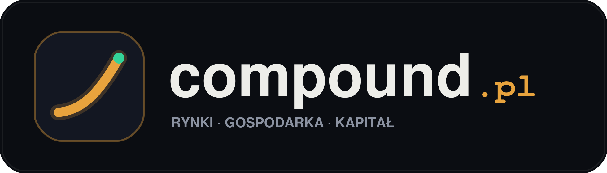

<p align="center">
  
</p>

<h1 align="center">compound.pl</h1>

<p align="center">
  Portal informacyjno-analityczny dla inwestorów i przedsiębiorców łączący strumienie danych rynkowych z syntezą AI oraz analizą fundamentalną spółek.
</p>

<p align="center">
  <a href="https://skibidibobus.github.io/compound.pl/"><strong>Wersja demonstracyjna online (GitHub Pages)</strong></a>
  &nbsp;·&nbsp;
  <a href="docs/Architektura.md">Architektura</a>
  &nbsp;·&nbsp;
  <a href="docs/Bezpieczenstwo-i-Compliance.md">Bezpieczeństwo i KNF/MAR</a>
  &nbsp;·&nbsp;
  <a href="CHANGELOG.md">Historia zmian</a>
</p>

<p align="center">
  
  
  
  
  
</p>

---

## O projekcie

**compound.pl** to aplikacja webowa agregująca notowania rynkowe, depesze gospodarcze oraz opracowania fundamentalne w jednym interfejsie typu terminalowego. System pobiera dane z oficjalnych źródeł (NBP, GPW, rynki amerykańskie, surowce, kryptowaluty), tłumaczy wybrane publikacje zagraniczne na język polski i przetwarza je przez moduł analityczny oparty na modelu Google Gemini (z deterministycznym silnikiem zapasowym).

Projekt został zaprojektowany z naciskiem na rzetelność danych (ekstrakcja wskaźników wyłącznie z treści źródłowej), bezpieczeństwo warstwy serwerowej oraz zgodność z regulacjami rynku kapitałowego (KNF i Rozporządzenie MAR).

---

## Główne moduły

### 1. Agregacja danych rynkowych (`fetcher.py`)
- Równoległy pobór oficjalnych tabel kursów średnich walut (Tabela A) oraz ceny złota z API Narodowego Banku Polskiego wraz z wyliczeniem realnej zmiany procentowej między sesjami.
- Notowania indeksów i spółek z GPW (m.in. WIG20, PKO BP, XTB, Dino, Kruk, Grupa Kęty, Budimex, CD Projekt, PZU, Orlen, KGHM), rynku amerykańskiego (S&P 500, NVIDIA, Microsoft), surowców (Ropa Brent) i kryptowalut (BTC, ETH).
- Wielokanałowy agregator kanałów RSS podzielony na pięć działów tematycznych (`Rynki & GPW`, `Makro & Biznes`, `Tech & AI`, `Świat`, `Sport`) z automatyczną deduplikacją i tłumaczeniem prasy zagranicznej (CNBC, BBC, TechCrunch, Ars Technica) na język polski.

### 2. Moduł analityczny AI (`ai_engine.py`)
- Przetwarzanie depesz z wykorzystaniem API Google Gemini oraz lokalnego silnika regułowego w przypadku braku klucza API.
- Ekstrakcja twardych wskaźników liczbowych z tekstu bez generowania danych spoza źródła.
- Klasyfikacja wpływu rynkowego (`HIGH`, `MEDIUM`, `LOW`), ocena wydźwięku oraz generowanie zwięzłego podsumowania i kontekstu dla inwestora.

### 3. Analizy długoterminowe (`long_term_analyses.py`)
- Dział `Analizy Long-Term` prezentujący obiektywne opracowania modeli biznesowych 12 wybranych spółek z GPW i Wall Street w horyzoncie wieloletnim.
- Zestawienie wskaźników fundamentalnych, filarów przewagi konkurencyjnej, bieżących katalizatorów oraz czynników ryzyka.
- Trzy przykładowe modele alokacji kapitału w celach edukacyjnych i porównawczych.

### 4. Narzędzia i interfejs użytkownika (`index.html`)
- Wbudowany czytnik artykułów pozwalający zapoznać się z pełnym opracowaniem bez opuszczania strony.
- Moduł `Briefing 60s` zestawiający kluczowe wydarzenia dnia z możliwością skopiowania gotowego podsumowania.
- Kalkulator walutowy oparty na bieżących kursach NBP oraz kalkulator procentu składanego porównujący zwykły rachunek maklerski (19% podatku od zysków kapitałowych) z kontem IKE.
- Automatyczne odświeżanie danych aktywne wyłącznie podczas obecności użytkownika na karcie przeglądarki.

### 5. Panel administratora i bezpieczeństwo (`admin.html`, `admin_manager.py`, `server.py`)
- Uwierzytelnianie oparte na skrócie `PBKDF2-HMAC-SHA256` (120 000 iteracji z indywidualną solą kryptograficzną) oraz 256-bitowych tokenach sesyjnych.
- Ochrona przed atakami brute-force (czasowa blokada po 5 nieudanych próbach logowania).
- Blokada dostępu HTTP (`403 Forbidden`) do plików źródłowych Pythona, plików konfiguracyjnych, `.env`, `.git` oraz wewnętrznego pliku stanu `admin_state.json`.
- Nagłówki bezpieczeństwa HTTP (`X-Content-Type-Options`, `X-Frame-Options`, `Referrer-Policy`).
- Podgląd limitów zapytań API, stanu kanałów RSS, statystyk ruchu, logów audytowych oraz zarządzanie komunikatem redakcyjnym.

---

## Struktura repozytorium

```text
compound.pl/
├── index.html                  # Główny interfejs aplikacji webowej
├── admin.html                  # Panel administratora (metryki, limity API, konfiguracja)
├── server.py                   # Serwer HTTP i warstwa REST API
├── fetcher.py                  # Agregator danych rynkowych i kanałów RSS
├── ai_engine.py                # Moduł analizy tekstu (Google Gemini API i silnik zapasowy)
├── long_term_analyses.py       # Baza analiz fundamentalnych i modeli alokacji
├── admin_manager.py            # Zarządzanie sesjami, bezpieczeństwem, telemetrią i konfiguracją
├── run.py                      # Skrypt uruchamiający aplikację lokalnie
├── data.json                   # Bieżąca migawka danych rynkowych i depesz
├── requirements.txt            # Lista zależności języka Python
├── .env.example                # Szablon zmiennych środowiskowych
├── .github/workflows/          # Harmonogram automatycznej aktualizacji danych (GitHub Actions)
├── assets/brand/               # Zestaw materiałów graficznych i logotypów (SVG oraz PNG)
└── scripts/                    # Skrypty pomocnicze do generowania zasobów graficznych
```

---

## Uruchomienie lokalne

### Wymagania
- Python 3.9 lub nowszy

### Instalacja i start

```bash
# 1. Pobranie repozytorium
git clone https://github.com/skibidibobus/compound.pl.git
cd compound.pl

# 2. Instalacja zależności (opcjonalnie, dla pełnej obsługi skryptów pomocniczych)
pip install -r requirements.txt

# 3. Konfiguracja zmiennych środowiskowych (opcjonalnie)
cp .env.example .env
# W pliku .env można podać własny klucz GEMINI_API_KEY.
# Bez klucza aplikacja korzysta z wbudowanego lokalnego silnika analitycznego.

# 4. Uruchomienie serwera
python3 run.py
```

Po uruchomieniu aplikacja jest dostępna pod adresem `http://localhost:8000`, a panel administratora pod adresem `http://localhost:8000/admin`.

---

## Automatyzacja aktualizacji danych

Repozytorium zawiera konfigurację GitHub Actions w pliku `.github/workflows/update_data.yml`, która cyklicznie uruchamia `fetcher.py` i zapisuje zaktualizowany plik `data.json`. Aby aktywować analizę z użyciem modelu Gemini w ramach GitHub Actions, należy dodać sekret `GEMINI_API_KEY` w ustawieniach repozytorium (`Settings -> Secrets and variables -> Actions`).

---

## Dokumentacja techniczna

Szczegółowe opracowania dotyczące działania systemu znajdują się w katalogu `docs/` oraz w plikach informacyjnych repozytorium:

- [Architektura systemu](docs/Architektura.md) — przepływ danych, warstwy aplikacji i model hybrydowy
- [Bezpieczeństwo i zgodność regulacyjna](docs/Bezpieczenstwo-i-Compliance.md) — uwierzytelnianie `PBKDF2`, izolacja plików, KNF i Rozporządzenie MAR
- [Automatyzacja i integracje API](docs/Automatyzacja-i-API.md) — harmonogramy GitHub Actions, źródła danych i publikacja na X
- [Polityka bezpieczeństwa](SECURITY.md) — zasady zgłaszania podatności i wdrożenia
- [Zasady współtworzenia](CONTRIBUTING.md) — standardy kodu i proces zmian
- [Historia zmian](CHANGELOG.md) — dziennik kolejnych wydań

---

## Nota prawna (KNF / MAR)

Treści prezentowane w serwisie mają charakter wyłącznie informacyjny, analityczny i edukacyjny. Nie stanowią doradztwa inwestycyjnego w rozumieniu Art. 76 Ustawy o obrocie instrumentami finansowymi ani rekomendacji inwestycyjnych w rozumieniu Rozporządzenia MAR (UE nr 596/2014).

---

## Licencja

Projekt jest udostępniany na licencji MIT. Szczegóły znajdują się w pliku [LICENSE](LICENSE).
